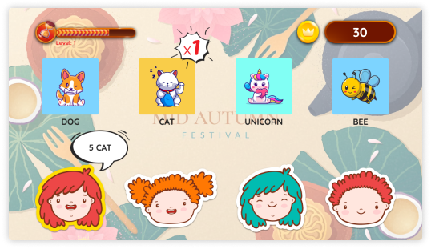

# MiniGame

Two small HTML5 marketing mini-games you can open in a browser or host as static files. No build step and no backend.

| Game | What it is | Folder |
|---|---|---|
| Guess Me | Match the product the character asks for before time runs out. English and Vietnamese. | [games/guess-me](games/guess-me) |
| Lucky Spin | Spin the wheel to win prizes, with a rank table. | [games/spin-wheel](games/spin-wheel) |



## Run locally

Any static server works. From this folder:

```bash
python -m http.server 8000
```

Then open `http://localhost:8000/games/guess-me/` or `http://localhost:8000/games/spin-wheel/`.

Opening `index.html` directly from disk may fail for the language files (`fetch` is blocked on `file://`), so use a server.

## Publish

Both games are plain static folders. Upload either folder to GitHub Pages, Netlify or any web host. The pages load jQuery, Bootstrap and Google Fonts from public CDNs, so visitors need internet access.

## Data and privacy

The registration form asks for name, email and phone number. Everything is kept in the visitor's own browser (`localStorage`); nothing is sent to a server. If you connect these games to a backend, add your own privacy notice and consent.

## Customize

- Text and language: `games/guess-me/assets/lang/en.json` and `vi.json`.
- Products and characters: images in `games/guess-me/assets/img/` and the lists at the top of `assets/js/game.js`.
- Prizes and wheel: `games/spin-wheel/assets/js/main.js`.

## License

- Code: [MIT](LICENSE).
- Original images, text and audio created for this project: [CC BY 4.0](LICENSE-CONTENT.md).
- Third-party material keeps its own terms. See [ASSETS.md](ASSETS.md) before reusing any image or sound.
